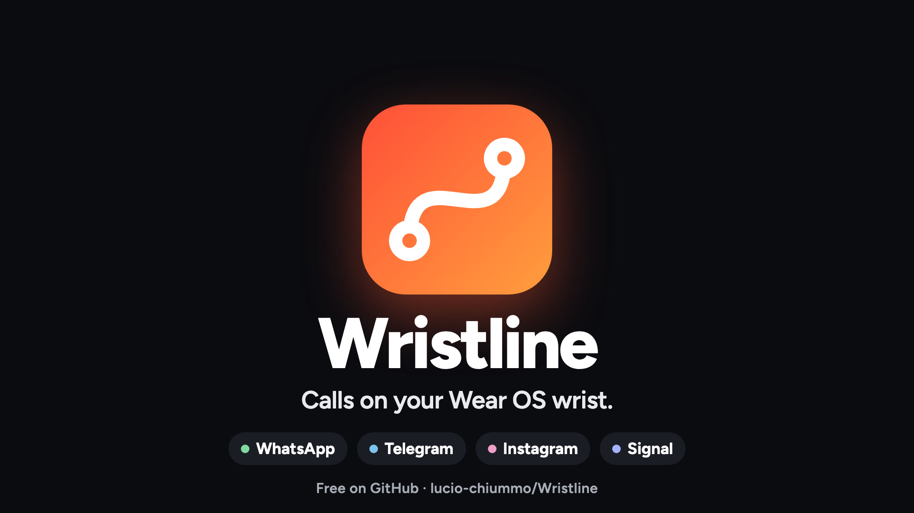

<p align="center"></p>

<h1 align="center">Wristline</h1>

<p align="center">Take WhatsApp, Telegram, Instagram and Signal calls on your Wear OS watch: ring, answer, decline, hang up, and optionally talk through the watch.</p>

<p align="center">
  <a href="https://github.com/lucio-chiummo/Wristline/actions/workflows/build.yml"></a>
  <a href="https://github.com/lucio-chiummo/Wristline/releases/latest"></a>
  <a href="LICENSE"></a>
  
  
</p>

<p align="center"><a href="docs/brand/wristline-launch.mp4"></a></p>

Wristline is a small Android app for the **phone**, with an optional app for the watch. It exists because these apps don't ring on the watch on their own. WhatsApp's watch app even stops the phone from forwarding call notifications while its servers never send the calls to the watch, and the Pixel Watch app drops Instagram's call notifications. So calls ring nowhere on the watch.

## What's in this repository

Two Android apps, built together and released together:

- **The phone app** (`app/`). This is Wristline itself. It notices a call from WhatsApp, Telegram, Instagram or Signal, makes the watch ring, presses the app's own Answer, Decline and Hang up buttons for you, and, if you want, moves the call's voice to the watch.
- **The watch app** (`wear/`), optional. It shows a full-screen incoming call with Answer and Decline, its own call screen, and lets you call your contacts from the watch.

Also here: the step-by-step guide and design notes (`docs/`), and a script that records how a calling app behaves during a call, used when adding a new app (`tools/`). Everything runs on your phone and watch. There's no server and no account.

**New here? Follow the [step-by-step guide](docs/HOW_TO.md).** It covers installing, setup, everyday use and what to do if something goes wrong.

**Contents:** [What it can do](#what-it-can-do) · [Where it works](#where-it-works) · [Install](#install) · [Setup](#setup) · [How it works](#how-it-works) · [Under the hood](#under-the-hood) · [Troubleshooting](#troubleshooting) · [Build](#build) · [License](#license)

## What it can do

**When someone calls you**

- Your watch rings like a normal phone call, showing the app and who's calling. With the watch app, it shows a full-screen incoming call and vibrates for the whole ring.
- Answer, decline or hang up from your wrist. On a Pixel Watch, a double pinch answers or hangs up and turning your wrist declines.
- Talk through the watch's own speaker and microphone, without touching your phone. This needs a one-time setup, on the phone or with a computer. It also works on phones that keep pulling the voice back to the phone, such as Xiaomi and POCO phones with HyperOS: see [Phones that pull the voice back](#phones-that-pull-the-voice-back).
- Move the voice between the watch and the phone during a call.
- See missed calls on the watch, with **Call back** for contacts.

**When you want to call someone** (needs the watch app and a one-time install with a computer)

- Search your contacts on the watch, or tap **WhatsApp**, **Telegram** or **Signal** on its home screen to see just the people you can reach there, A to Z.
- Tap a name to call them, and choose the app if they're on both.
- Keep your favourite people one tap away, and call back from your latest calls, each marked with the app it came from (W, T, S).
- Call with one tap from a tile or a watch-face complication.
- Use the call screen on the watch: mute when the app allows it, change the volume with the crown, hang up, or minimise it.

**Your rules**

- Choose which apps ring the watch: WhatsApp, Telegram, Instagram and Signal.
- Pause it any time, from the app, Quick Settings or the watch tile.
- Follow your phone's Do Not Disturb.
- Stop the watch ringing while you're using the phone.

Instagram can't start calls from outside its own app, so calling from the watch works with WhatsApp, Telegram and Signal.

## What you get

| | Voice on the phone | Voice through the watch |
|---|---|---|
| Watch rings like a normal phone call, showing "WhatsApp · Annaly" | ✅ | ✅ |
| Answer / decline from the watch | ✅ | ✅ |
| Hang up from the watch | ✅ (call-controls card) | ✅ (call screen) |
| Talk through the watch speaker and mic | ❌ phone or earbuds | ✅ |
| Extra setup | none | a one-time setup on the phone, or an `adb` command from a computer |

| App | Ring + answer on the watch | Voice through the watch |
|---|---|---|
| WhatsApp | ✅ tested | ✅ tested |
| Instagram | ✅ tested | ✅ tested, no setup needed (Instagram can't see the call state) |
| Telegram | ✅ tested | ✅ tested, same one-time setup as WhatsApp |
| Signal | ✅ tested | ✅ tested, same one-time setup as WhatsApp |

Also:
- **Ring my watch** (Home): a test call that checks calls reach the watch, no one needs to call you.
- **Missed calls on the watch**, with **Call back** for contacts (WhatsApp's own missed-call
  notifications never reach the watch).
- **Follows Do Not Disturb**: a call your phone would silence doesn't ring the watch; favourites and
  repeat callers your phone lets through still do (Home → **When the watch rings** to turn it off).
- **Ring with a notification** (Home → **When the watch rings**): for watches where Answer on the
  call screen does nothing (seen with OPPO's OHealth). The watch buzzes every few seconds with
  Answer and Decline. With voice through the watch set up and a watch that carries call audio, you
  talk on the watch; otherwise on the phone. Offered when **Ring my watch** goes unanswered.
- **Pause from anywhere**: Home's switch, a Quick Settings tile, or the chip on the watch tile.
- **Not while I'm using the phone** (optional): calls ring only the phone while it's unlocked in your hand.
- **Share diagnostic report** (Home): setup, recent events, your phone and watch models, and the
  apps on the phone that pass calls to a watch, without caller names or numbers, through the share
  sheet only. It shows when recent calls happened, so check it before posting it
  in a public issue.

### Calling from the watch

Wristline also has a **watch app**. Turn on **Call from the watch** on the phone (asks for Contacts and Phone), then open Wristline on the watch:

- Home: search everyone, your 3 latest calls (tap to call back; **All recent** for the rest), and buttons for **Favourites**, **WhatsApp**, **Telegram** and **Signal**. Each button opens just those people, A–Z; tapping a name there calls on that app. Hold a name to star it.
- Tap a name to call; the call starts in that app on the phone and the voice goes through the watch.
- Wristline's own call screen on the watch: *Calling… → Ringing… → call timer*, one-tap red hang-up, **Mute** when the app's call notification offers it, **Minimise** (open Wristline again to come back), the crown changes the call volume.
- A tile with your favourites first, then recent people.

Telegram contacts appear only if Telegram's **Sync contacts** is on. Instagram can't start calls from outside the app.

## Where it works

Wristline needs Android 12 or newer on the phone and a Wear OS watch. It has been tested on these devices:

| Phone | Android | Watch | Companion app | What works |
|---|---|---|---|---|
| vivo X300 Pro | 17 | Pixel Watch 5 | Pixel Watch | Everything: ringing, answering, voice through the watch, calling from the watch, with WhatsApp, Telegram, Instagram and Signal |
| POCO F8 Pro (HyperOS) | 17 | OPPO Watch (OWWE261) | OHealth | Ringing, answering on the watch's full screen, voice through the watch both ways, and calling from the watch, with WhatsApp. Needs **Ring with a notification** and the [Wristline — voice on watch](#phones-that-pull-the-voice-back) calling account |

Other phones and watches should work but haven't been tested. Two things vary between brands:

- **The companion app.** It decides how a call shows on the watch. The Pixel Watch app shows Wristline's call as a real call. OPPO's OHealth loses the Answer button, so turn on **Ring with a notification** there.
- **The phone's software.** Some phones close Wristline in the background or move the call's voice back to the phone. Wristline tells you when it sees this and what to change.

If you try another phone or watch, please open an issue and say what worked, with a diagnostic report if something didn't.

## Requirements

- Android 12 or newer, with WhatsApp, Telegram, Instagram or Signal installed.
- A Wear OS watch connected through its companion app. See [Where it works](#where-it-works) for the ones tested.
- The watch's **Call audio** Bluetooth profile switched on (phone Settings → Bluetooth → your watch).

## Install

Download the APKs from the [latest release](https://github.com/lucio-chiummo/Wristline/releases/latest). Wristline isn't on Google Play yet.

**Phone (required).** Open `wristline-phone-1.5.1.apk` on your phone and allow installing from that source when Android asks. Play Protect may warn that it doesn't know the developer. Then follow [Setup](#setup). This is all you need for calls to ring on the watch, and to answer them there.

Android blocks Notification access for apps installed from a file. If the switch is greyed out: App info → ⋮ (top right) → **Allow restricted settings**, then try again.

**Watch (optional).** Needed for the full-screen incoming call and for [calling from the watch](#calling-from-the-watch). Wear OS has no file installer, so this takes a computer with [adb](https://developer.android.com/tools/releases/platform-tools):

1. On the watch: Settings → System → About, then tap **Build number** 7 times.
2. In Developer options, turn on **ADB debugging** and **Wireless debugging**, then tap **Pair new device**.
3. On the computer, using the addresses and code the watch shows:

   ```sh
   adb pair <ip>:<pairing-port> <code>
   adb connect <ip>:<port>
   adb -s <ip>:<port> install wristline-watch-1.5.1.apk
   ```

4. Turn Wireless debugging off again.

Install both APKs from the same release. They only talk to each other when signed with the same key, so a watch app you built yourself won't connect to the released phone app.

### Check your download

Wristline asks for sensitive access, including your call notifications, so only install APKs from this repository's releases. Copies from anywhere else may have been changed.

Each release lists the SHA-256 hash of its APKs. To check a file, compare the hash from `shasum -a 256 wristline-phone-1.5.1.apk` with that list. To check who signed it, run `apksigner verify --print-certs wristline-phone-1.5.1.apk` (`apksigner` is in the Android SDK build-tools). The certificate's SHA-256 digest must be:

```text
290f69c60854208f97f093ee80aaa8e1bd73fea6c01be69dde8ec9e02dcb2ef4
```

## Setup

Open Wristline. The status card at the top says what's left to do, with one button for it:

1. **Notification access**: notices incoming calls from the apps you turned on.
2. **Notifications**: for call controls and alerts.
3. **Display over other apps**: opens the call when you tap Answer on the watch.
4. **Unrestricted battery**: stops the phone from closing Wristline in the background.

When the card turns green ("Ready"), calls ring on the watch. Use the switches to choose which apps are relayed, or pause relaying altogether with **Relay calls to my watch**. WhatsApp is on by default, Telegram, Instagram and Signal are off.

### Voice through the watch

You can set this up on the phone alone, or with a computer. Either way it's once for each app.

**On the phone**

1. In Wristline, open **Voice through the watch**, tap **Set up on this phone** and agree.
2. Follow the guide: allow notifications, join Wi-Fi, and turn on Developer options (Settings → About phone → tap **Build number** 7 times).
3. In Developer options, turn on **Wireless debugging**, then tap **Pair device with pairing code**.
4. Type the 6-digit code into Wristline's notification.
5. When Wristline says it's done, turn Wireless debugging off.

Wristline pairs with your phone's own Wireless debugging, keeps the key it paired with in the phone's Keystore (where the Keystore can't hold it, in Wristline's private storage, protected by a Keystore key where possible), and runs only `appops set --uid <package> READ_PHONE_STATE ignore` (or `allow` to undo), `am kill <package>`, and, after a call while Wireless debugging is on, three read-only commands for the diagnostic report (`logcat`, `dumpsys audio` and `dumpsys bluetooth_manager`, filtered to lines about call audio and the Bluetooth voice link). Apps you set up this way are repaired silently after an update when Wireless debugging is on and the key is still authorised. Turning voice off for the last app deletes the key. **Forget this phone's key** on the Voice screen deletes it too.

**With a computer**

This takes a computer with [adb](https://developer.android.com/tools/releases/platform-tools):

1. On the phone: Settings → About phone → tap **Build number** 7 times, then turn on **USB debugging** in Developer options.
2. Connect the phone to the computer and allow debugging when the phone asks.
3. In Wristline, open **Voice through the watch**, tap **Set up with a computer** and choose the app. It shows the exact command, for example:

   ```sh
   adb shell appops set --uid com.whatsapp READ_PHONE_STATE ignore
   ```

4. Run it, close that app once, and tap **I've run it**.
5. Turn USB debugging off again.

If an app update resets the setting and you used the computer, Wristline notices on the next call and asks you to tap **Repair**, which shows the command again.

### Phones that pull the voice back

On some phones, Xiaomi and POCO phones with HyperOS among them, the calling app takes the voice back to the phone a second after you answer on the watch. Wristline notices this on the first call and shows a card on Home. Tap it and turn on the calling account **Wristline — voice on watch** (Android leaves new calling accounts off). From the next call on, Wristline relays the call as a phone call of its own, which the calling app can't take the voice from.

If the card can't open the right screen, look in the phone's Settings for **Calling accounts** (or **Call settings**) and turn on "Wristline — voice on watch" there.

## How it works

When an app rings, Wristline registers a matching call with Android's own calling system, and the watch's companion app shows that call on the watch as a real call. Tapping **Answer** on the watch presses the app's own Answer button. For voice through the watch, Wristline first activates its call, so Android connects the watch as the Bluetooth call headset, and only then answers the app. The app's audio then goes through the watch.

Voice through the watch needs one setting changed for each app that can see the phone's call state (WhatsApp, Telegram, Signal), because otherwise the app sees "another call" and hangs up. Wristline sets that app's `READ_PHONE_STATE` app-op to `ignore`. The app keeps its Phone permission and works normally otherwise.

## Under the hood

Two Java apps, about 13,000 lines, with about 12,000 lines of unit tests. No servers. The phone app's only library is Google Play services for Wear OS; the watch app adds AndroidX Wear libraries.

| Part | Built on |
|---|---|
| Noticing calls | A `NotificationListenerService` that reads each calling app's call notification and its Answer, Decline and Hang up actions |
| Ringing the watch | Android's Telecom framework: a `ConnectionService` places a matching call, which the watch's companion app shows as a real phone call |
| Voice on the watch | Telecom call audio and Bluetooth headset routing. On phones that pull the voice back, the call is relayed as a managed call on Wristline's own calling account |
| Phone ↔ watch | The Wear OS Data Layer, carrying ring, answer and hang-up messages, contacts and call state |
| Setup without a computer | A built-in client for Android's Wireless debugging: mDNS discovery, pairing with SPAKE2 over TLS (with its own Ed25519 arithmetic), and the adb protocol, limited to a fixed set of commands |
| Watch app | Full-screen incoming call, call screen, contacts, a tile and a watch-face complication; Pixel watch gestures |

Some of the harder problems:

- **Android 17 moved the voice off the watch.** Reading Android's own audio and Telecom source showed how it picks who controls call audio ([write-up](docs/ANDROID17_VOICE_ROUTE.md)). The fix is the managed relay above.
- **Debugging phones I don't own.** HyperOS behaved differently from the phones I had. The diagnostic report records the call's audio route, Bluetooth link and Telecom events, with names and numbers left out, so each beta round with a tester came back with the evidence for the next fix.
- **Vendor quirks.** Xiaomi stops the notification listener without telling the app, so Wristline notices and rebinds it. OPPO's companion app loses Answer, so the watch can ring by notification instead.

Quality and safety:

- Unit tests for both apps with Robolectric, run in CI on every push.
- Every Gradle dependency is checked against a pinned SHA-256 hash, and CI actions are pinned to exact commits.
- Releases are signed in a separate, hand-started workflow, and the APKs' certificate and hashes are published so anyone can check a download.
- Design specs, plans and test write-ups are in [`docs/`](docs/).


## Side effects of voice through the watch

- During a call, the app won't notice a normal phone call coming in.
- Wristline shows up as a calling account named "Wristline" in the phone's settings.
- On [phones that pull the voice back](#phones-that-pull-the-voice-back), there's a second calling account, "Wristline — voice on watch", and the phone's dialer shows a Wristline call while a relayed call is on.

## Troubleshooting

The [guide](docs/HOW_TO.md#if-something-goes-wrong) has more. The most common problems:

| Symptom | Fix |
|---|---|
| Call drops right after answering on the watch | The app reset its setting. Wristline shows **Voice needs repair**: tap **Repair**. |
| Watch doesn't ring at all | If the card says **Wristline isn't receiving notifications**, tap **Fix**. On Xiaomi also turn on Autostart for Wristline. Open Wristline: the card must say **Ready**, and the app's switch must be on. Then tap **Ring my watch**: if the test call rings, Wristline and the watch are fine and the calling app's notification is the problem. |
| Voice stays on the phone | Turn the watch's **Call audio** Bluetooth setting off and on. If Home shows a card about the voice, follow it: see [Phones that pull the voice back](#phones-that-pull-the-voice-back). |
| No calls arrive at all, even on the phone | The app may have been force-stopped. Open it once. |
| Phone silent for WhatsApp messages, watch shows them | That's the Pixel Watch app muting the phone while you wear the watch, not Wristline. |

Logs: `adb logcat -s Wristline`.

## Build

Requires JDK 21+ (Android Studio's bundled JDK works) and the Android SDK. The Gradle wrapper downloads everything else, including SDK platform 37 if licences are accepted.

```sh
./gradlew testDebugUnitTest :wear:testDebugUnitTest  # unit tests (phone + watch)
./gradlew assembleDebug :wear:assembleDebug          # debug APKs → app/ and wear/build/outputs/apk/debug/
./gradlew assembleRelease :wear:assembleRelease      # release APKs → app/ and wear/build/outputs/apk/release/
```

From the command line, point `JAVA_HOME` at a JDK 21 or newer if your default is older.

Release builds are signed from `keystore.properties` in the project root (gitignored), or from the file `WRISTLINE_KEYSTORE_PROPERTIES` points to, which lets you keep your key outside the project:

```properties
storeFile=/absolute/path/to/your.keystore
storePassword=...
keyAlias=...
keyPassword=...
```

The phone and watch apps share one version, set in `gradle.properties` (`wristline.versionCode`, `wristline.versionName`); the watch's versionCode is that plus 1000, so the two APKs of the same package never share a code. Both apps must be signed with the same key, or the watch and phone can't talk to each other.

Neither the keystore nor that file is in the repository; keep your own copies safe.

### Releasing

Releases are built, signed and published by the **Release** workflow (`.github/workflows/release.yml`), started by hand from `main` (Actions → Release → Run workflow). It releases the version in `gradle.properties` with the notes in `docs/releases/<version>.md`, adds the APKs' SHA-256 hashes to the notes, and marks versions with a `-` (like `1.6-beta1`) as pre-releases. It stops if the tag already exists, and won't publish an APK that isn't signed with the certificate above.

The signing key is kept only in the repository's protected `release` environment, as four secrets: `WRISTLINE_KEYSTORE_BASE64` (the keystore file, base64-encoded), `WRISTLINE_STORE_PASSWORD`, `WRISTLINE_KEY_ALIAS` and `WRISTLINE_KEY_PASSWORD`. No other workflow can read them. To release: raise the version in `gradle.properties`, add the notes file, merge to `main`, then run the workflow. Privacy policy: [PRIVACY.md](PRIVACY.md). Reporting a vulnerability: [SECURITY.md](SECURITY.md).

Gradle checks every dependency against the hashes in `gradle/verification-metadata.xml`. After changing a dependency or the Android Gradle plugin, update them and review the diff. Start from an empty Gradle home: with a filled cache Gradle misses parent POMs, and CI's clean build then fails.

```sh
GRADLE_USER_HOME=$(mktemp -d) ./gradlew --write-verification-metadata sha256 --continue testDebugUnitTest :wear:testDebugUnitTest assembleDebug :wear:assembleDebug :app:assembleShrunk assembleRelease :wear:assembleRelease
```

That only records artifacts for the system it runs on. A new Android Gradle plugin version brings a new `aapt2` for each system, so also add the hashes of its `linux`, `osx` and `windows` jars from [Google's Maven repository](https://dl.google.com/android/maven2/com/android/tools/build/aapt2/maven-metadata.xml), or CI and other contributors' builds will fail.

## Uninstall

Uninstall Wristline normally. If you used voice through the watch, give the apps their setting back first: Voice through the watch → **Turn off voice through the watch**. If you set an app up on the phone, Wristline does it for you, with Wireless debugging on. If you used a computer, it shows the command to run: `adb shell appops set --uid <package> READ_PHONE_STATE allow`.

## License

Wristline's source code is public, but it isn't open source in the formal sense: it's under the [PolyForm Noncommercial License 1.0.0](LICENSE). The source for each release is at its tag in this repository.

In short:

- You can use, study, change and share it for noncommercial purposes, such as personal use, hobby projects, research, or use by a charity, school or public body.
- You can't use it for anything else, such as selling it or building it into a paid product, without permission from Lucio Chiummo. To ask, open an issue.
- If you share a copy, include those terms (or their URL) and the Required Notice line in [NOTICE](NOTICE).
- The name "Wristline" and its logo and icon aren't licensed. A changed version needs its own name and icon, and can't suggest it comes from the Wristline project.

This summary doesn't replace the license. Third-party components keep their own licenses, listed in [NOTICE](NOTICE).

## Disclaimer

Wristline doesn't modify the apps it relays and never reads, records or transmits call audio. It only presses the apps' own notification buttons, and Android routes the audio. It has no servers, accounts or analytics. It asks for the internet permission only to talk to your phone's own Wireless debugging over the phone's own Wi-Fi address: nothing leaves the phone. The key it pairs with lives in the phone's Keystore. On phones where the Keystore can't hold it, it is kept in Wristline's private storage, protected by a Keystore key where possible. You can delete it with **Forget this phone's key** on the Voice screen, or revoke it in Developer options → Wireless debugging → Paired devices (the entry is `wristline@<model>`). The only commands it runs are the app-op ones above and `am kill`, and you can switch Wireless debugging off right after setup. Wristline doesn't check the certificate of the Wireless debugging it connects to, so another app on the phone could pretend to be it and fake its replies; that app would gain nothing, because Android trusts Wristline only through the pairing code and Wristline sends only those fixed commands. Data for the watch goes through Google's Wear OS connection ([privacy policy](PRIVACY.md)). It is an independent project, not affiliated with WhatsApp, Meta, Telegram or Google, and may break if those apps or Wear OS change how calls work.
